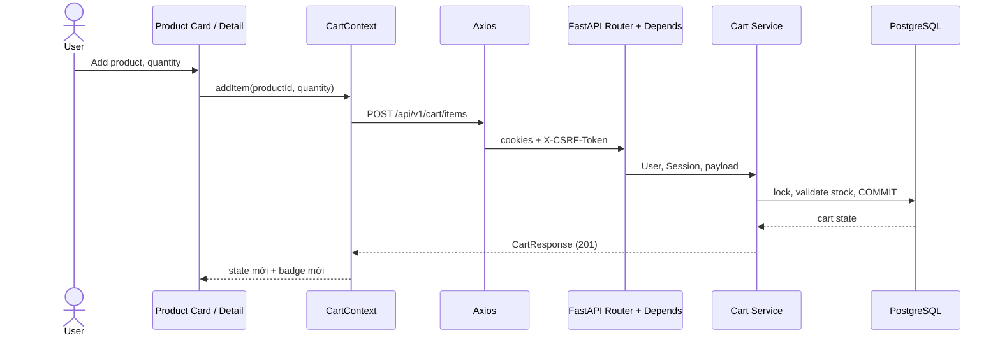

# Phase 11 — Shopping Cart

Tài liệu này giải thích implementation Cart đang có trong Product Catalog. Các
đoạn Python/TypeScript có ghi đường dẫn là code thật đã được rút ngắn; SQL hoặc
đoạn ghi **minh họa** chỉ dùng để làm rõ cơ chế.

## Mục lục

1. [Shopping Cart hoạt động như thế nào?](#1-shopping-cart-hoạt-động-như-thế-nào)
2. [Vì sao cần Cart và CartItem?](#2-vì-sao-cần-cart-và-cartitem)
3. [Foreign Key và Relationship khác nhau thế nào?](#3-foreign-key-và-relationship-khác-nhau-thế-nào)
4. [Unique và Check Constraint làm gì?](#4-unique-và-check-constraint-làm-gì)
5. [Cascade và passive_deletes là gì?](#5-cascade-và-passive_deletes-là-gì)
6. [SQLAlchemy Session là gì?](#6-sqlalchemy-session-là-gì)
7. [`add`, `flush`, `commit`, `rollback` khác nhau ra sao?](#7-add-flush-commit-rollback-khác-nhau-ra-sao)
8. [Transaction và ACID là gì?](#8-transaction-và-acid-là-gì)
9. [Row lock hoạt động thế nào?](#9-row-lock-hoạt-động-thế-nào)
10. [Race condition và lost update là gì?](#10-race-condition-và-lost-update-là-gì)
11. [`ON CONFLICT DO NOTHING` dùng để làm gì?](#11-on-conflict-do-nothing-dùng-để-làm-gì)
12. [Vì sao Cart phải kiểm tra stock?](#12-vì-sao-cart-phải-kiểm-tra-stock)
13. [Decimal dùng để tính tiền thế nào?](#13-decimal-dùng-để-tính-tiền-thế-nào)
14. [FastAPI Depends hoạt động thế nào?](#14-fastapi-depends-hoạt-động-thế-nào)
15. [React CartContext dùng để làm gì?](#15-react-cartcontext-dùng-để-làm-gì)
16. [AbortController và requestVersion khác nhau thế nào?](#16-abortcontroller-và-requestversion-khác-nhau-thế-nào)
17. [Cart đồng bộ sau mutation thế nào?](#17-cart-đồng-bộ-sau-mutation-thế-nào)
18. [Cart được test như thế nào?](#18-cart-được-test-như-thế-nào)

## 1. Shopping Cart hoạt động như thế nào?

Khi user bấm **Thêm vào giỏ**, React không tự lưu một mảng Product vào browser.
`StoreProductCard.tsx` hoặc `StorefrontProductPage.tsx` gọi `addItem()` trong
`frontend/src/cart/CartContext.tsx`. Context gọi Axios, FastAPI xác thực user,
service lock/kiểm tra database rồi trả Cart mới. Context nhận response và badge
trên header re-render theo `total_quantity`.



`backend/app/api/v1/endpoints/cart.py` chịu HTTP/dependency; `backend/app/services/cart.py`
chịu business logic và transaction. Đây gần với NestJS Controller → Guard/DTO →
Service. Frontend chỉ render snapshot; PostgreSQL mới quyết định quantity, price
và stock đúng khi nhiều request cùng đến.

## 2. Vì sao cần Cart và CartItem?

Một User có một Cart; Cart có nhiều CartItem; một Product có thể xuất hiện trong
Cart của nhiều User. `CartItem` là bảng nối có thuộc tính riêng là `quantity`.

| users | carts | cart_items | products |
| --- | --- | --- | --- |
| `id=7` | `id=21, user_id=7` | `cart_id=21, product_id=5, quantity=2` | `id=5, stock=10` |

Không lưu mảng product IDs trong `carts`: sẽ không có FK cho từng phần tử, không
biết quantity, khó cấm duplicate, và khó query. Phase 11 cũng không lưu price
snapshot trong CartItem; `_cart_response()` lấy `item.product.price` hiện tại.
Đó là lý do giá có thể đổi trong cart; Order ở phase sau mới cần snapshot giá.

## 3. Foreign Key và Relationship khác nhau thế nào?

Foreign Key (FK) là rule PostgreSQL. `cart_items.product_id` phải trỏ Product có
thật; database chặn row mồ côi. `relationship()` là metadata của SQLAlchemy để
code Python đi từ object này tới object kia.

```python
# backend/app/models/cart.py
cart_id: Mapped[int] = mapped_column(
    ForeignKey("carts.id", ondelete="CASCADE"), nullable=False
)
cart: Mapped[Cart] = relationship(back_populates="items")
```

`cart_id` là số nguyên trong DB; `cart` là object Python. PostgreSQL không cần
biết `relationship()`. Nếu không khai báo relationship, service vẫn query được
bằng `select(CartItem).where(CartItem.cart_id == cart.id)`, nhưng mất cách viết
`cart.items` và loader options. TypeORM `@ManyToOne`/`@OneToMany` và JPA
`@ManyToOne` cũng là ORM mapping; chúng không thay FK thật trong database.

Trong source, `Cart.items`, `CartItem.cart`, `CartItem.product`, `Product.cart_items`
và `User.cart` nối hai chiều bằng `back_populates`.

## 4. Unique và Check Constraint làm gì?

Migration `backend/migrations/versions/20261024_05_create_carts.py` tạo ba rule
quan trọng:

| Rule | Ý nghĩa | Nếu thiếu |
| --- | --- | --- |
| `UNIQUE(carts.user_id)` | Một User chỉ có một Cart. | Hai request đầu có thể tạo hai Cart. |
| `UNIQUE(cart_id, product_id)` | Một Product chỉ có một dòng trong Cart. | Cùng Product có nhiều dòng. |
| `CHECK(quantity > 0)` | Không có item quantity 0/âm. | Script/bypass API tạo dữ liệu vô nghĩa. |

Pydantic cũng validate `quantity > 0`, nhưng đó chỉ là lớp HTTP. Constraint còn
bảo vệ khi dữ liệu được ghi bởi script, SQL console hoặc API mới. Unique constraint
không tự cộng quantity; `add_item()` vẫn phải đọc, cộng và lưu quantity đúng.

## 5. Cascade và passive_deletes là gì?

Migration khai báo `ON DELETE CASCADE` từ Product → CartItem. Nếu admin hard-delete
Product đang nằm trong nhiều Cart, PostgreSQL xóa CartItem liên quan, tránh item
trỏ Product không tồn tại. Test
`test_cart_validation_isolation_and_product_delete_cascade` kiểm tra điều này.

Trong `backend/app/models/cart.py` và `product.py`, relationship dùng
`passive_deletes=True`. Đây là hướng dẫn cho ORM: khi parent bị xóa, đừng tải tất
cả child rồi DELETE từng object; để DB FK cascade làm việc. `passive_deletes` không
tự tạo cascade—FK trong Alembic migration mới là rule thật.

## 6. SQLAlchemy Session là gì?

Session là workspace ORM của một request, không đơn giản là một database
connection cố định. Nó theo dõi object đã load/thay đổi (identity map + Unit of
Work), mượn connection từ Engine/pool khi thực thi SQL, rồi được `close()` ở cuối
request.

```python
# backend/app/db/database.py
def get_db() -> Generator[Session, None, None]:
    session = get_session_factory()()
    try:
        yield session
    except Exception:
        session.rollback()
        raise
    finally:
        session.close()
```

`get_session_factory()` tạo `Engine` với pool settings và `sessionmaker` có
`autoflush=False`, `expire_on_commit=False`. Đừng share một Session cho concurrent
requests: pending changes và identity map của request A có thể lẫn với B. Session
gần `EntityManager` trong JPA hoặc manager/unit of work của TypeORM hơn là raw
connection.

## 7. `add`, `flush`, `commit`, `rollback` khác nhau ra sao?

| Lệnh | Làm gì | Có làm dữ liệu bền không? |
| --- | --- | --- |
| `db.add(obj)` | Đưa object mới vào Unit of Work. | Chưa. |
| `db.flush()` | Gửi INSERT/UPDATE/DELETE pending xuống DB trong transaction. | Chưa. |
| `db.commit()` | Flush nếu cần rồi COMMIT transaction. | Có. |
| `db.rollback()` | Hủy transaction chưa commit. | Không. |

Ví dụ thật trong `backend/tests/test_cart.py:create_product()`:

```python
category = Category(name="Cart-...")
db.add(category)
db.flush()  # Category có id để Product dùng, nhưng chưa COMMIT
db.add(Product(category_id=category.id, ...))
db.commit()
```

Nếu thêm Product lỗi trước `commit`, `rollback` có thể hủy luôn Category đã flush.
`backend/app/services/cart.py:add_item()` bao mutation trong `try/except`, gọi
`db.rollback()` trước khi re-raise. Nếu Session gặp database error mà không
rollback, query sau có thể fail vì Session còn transaction lỗi.

## 8. Transaction và ACID là gì?

Transaction gom nhiều SQL thành một đơn vị: hoặc tất cả thành công (`COMMIT`),
hoặc không gì được lưu (`ROLLBACK`). Trong Cart:

- **Atomicity:** tạo CartItem và tăng quantity không bị lưu nửa chừng.
- **Consistency:** FK, unique/check constraint và stock check giữ invariant.
- **Isolation:** lock khiến mutation xung đột chờ nhau thay vì ghi đè.
- **Durability:** sau commit, PostgreSQL chịu trách nhiệm giữ thay đổi theo cấu
  hình durability của server.

Project không đặt isolation level explicit trong `create_engine`. PostgreSQL
thường mặc định `READ COMMITTED`; đó là default PostgreSQL, không phải assertion
đã đo ở từng môi trường. Nếu cần xác minh, chạy `SHOW transaction_isolation;`.

## 9. Row lock hoạt động thế nào?

`with_for_update()` trong service biểu đạt SQL `SELECT ... FOR UPDATE`. Nó khóa
những **row được chọn** đến commit/rollback, không khóa cả table. Request khác
muốn update/lock cùng row thường chờ; SELECT thường vẫn đọc committed version nhờ
MVCC.

```python
# backend/app/services/cart.py
cart = db.scalar(
    select(Cart).where(Cart.user_id == user_id).with_for_update()
)
product = db.scalar(
    select(Product).where(Product.id == product_id).with_for_update()
)
```

Cart lock serialize thao tác trên cart của cùng User. Product lock serialize
stock validation của những Cart cùng Product. `add_item()` lock theo thứ tự Cart
→ Product → CartItem; thứ tự nhất quán giảm nguy cơ deadlock.

## 10. Race condition và lost update là gì?

Race condition là kết quả phụ thuộc timing hai request. Lost update là race phổ
biến: Cart quantity ban đầu 1, Tab A và B cùng add 1. Không lock, cả hai đọc 1,
cả hai ghi 2, kết quả sai là 2 thay vì 3.

| Thời điểm | Không lock | Có row lock |
| --- | --- | --- |
| A | đọc 1 | lock và đọc 1 |
| B | đọc 1 | chờ A |
| A | ghi 2 | ghi 2, commit |
| B | ghi 2 | đọc lại 2, ghi 3 |

`add_item()` lock `CartItem` bằng `with_for_update()` trước khi cộng. Transaction
không tự giải race chỉ vì có `commit`; phần read-modify-write cần lock hoặc atomic
SQL phù hợp.

## 11. `ON CONFLICT DO NOTHING` dùng để làm gì?

Hai request đầu tiên của cùng User có thể cùng phát hiện chưa có Cart. Check rồi
INSERT không an toàn vì cả hai cùng thấy “chưa có”. `_locked_cart()` dùng UPSERT:

```python
# backend/app/services/cart.py
db.execute(
    insert(Cart).values(user_id=user_id)
    .on_conflict_do_nothing(index_elements=[Cart.user_id])
)
```

SQL tương đương gần đúng:

```sql
INSERT INTO carts (user_id) VALUES ($1)
ON CONFLICT (user_id) DO NOTHING;
```

Unique constraint là điều PostgreSQL dùng để phát hiện conflict. Một request tạo
row, request kia không nổ `IntegrityError`, sau đó cả hai lock/read Cart đó. Đây
không phải `ON CONFLICT DO UPDATE`; project không dùng UPSERT CartItem vì cần
lock Product và kiểm stock tổng trước khi tăng quantity.

## 12. Vì sao Cart phải kiểm tra stock?

`_assert_stock(product, quantity)` so `product.stock` với quantity mới. Ví dụ
stock = 3, Cart đã có 2; hai request cùng add 1. Sau khi request đầu lock Product,
check và commit quantity 3, request sau lock lại thấy quantity 3 rồi check
quantity 4 > stock, nhận 409. Test concurrent near-stock kiểm expected one 201,
one 409 và quantity cuối 3.

Add Cart **không trừ Product stock** trong implementation hiện tại. Cart chỉ là
ý định mua; reservation/decrement chỉ nên được thiết kế rõ ở Checkout/Order.

## 13. Decimal dùng để tính tiền thế nào?

`Product.price` là `Numeric(10, 2)` mapped sang Python `Decimal`, không phải
`float`. Float binary có sai số như `0.1 + 0.2`; money cần kết quả ổn định.

```python
# backend/app/services/cart.py:_cart_response
line_total = item.product.price * item.quantity
subtotal = sum((item.line_total for item in items), Decimal("0"))
```

Pydantic serialize Decimal ra JSON, frontend khai báo `unit_price`, `line_total`,
`subtotal` là `string` trong `frontend/src/types/catalog.ts`, rồi format qua
`formatPrice()`. Giá lấy từ Product hiện tại, không nhận từ request frontend.

## 14. FastAPI Depends hoạt động thế nào?

`Depends` là dependency injection theo parameter. Trước khi gọi endpoint,
FastAPI resolve dependency và inject result:

```python
# backend/app/api/v1/endpoints/cart.py
def add_item(
    payload: CartItemCreate,
    current_user: User = Depends(get_current_user),
    db: Session = Depends(get_db),
    _: None = Depends(require_csrf),
) -> CartResponse:
    return cart_service.add_item(db, current_user, payload)
```

- `get_db`: Session riêng, close ở cuối request.
- `get_current_user`: verify access JWT/JTI blacklist, Redis session, active User.
- `require_csrf`: check Origin, access/session, CSRF cookie/header/session value.

Nó giống NestJS DI + Guard/Pipe: Pydantic payload là DTO validation, auth/CSRF
dependency gần Guard, service là Service. Cart không nhận `user_id` từ client,
nên ADMIN/USER cũng chỉ thao tác Cart của principal hiện tại.

## 15. React CartContext dùng để làm gì?

`CartProvider` trong `frontend/src/cart/CartContext.tsx` nằm bên trong
`AuthProvider` tại `frontend/src/App.tsx`. Nó giữ `cart`, `loading`, `error` và
methods mutation; `StorefrontShell` đọc badge, Product Card/Detail add, CartPage
update/remove/clear.

```tsx
const CartContext = createContext<CartValue | null>(null);

export function useCart() {
  const context = useContext(CartContext);
  if (!context) throw new Error("useCart must be used within CartProvider.");
  return context;
}
```

Context giải quyết prop drilling, không thay server state. Backend là source of
truth: POST/PATCH trả Cart thật, GET sau reload lấy Cart từ PostgreSQL. Không để
Cart trong `AuthContext` vì lifecycle/trách nhiệm khác; không dùng localStorage vì
stale, dễ lẫn tài khoản, và không biết price/stock mới.

## 16. AbortController và requestVersion khác nhau thế nào?

`AbortController` yêu cầu Axios hủy GET đang chờ khi effect cleanup. `requestVersion`
là `useRef` counter để bỏ qua response cũ nếu nó vẫn về sau khi user đã đổi.

```tsx
# frontend/src/cart/CartContext.tsx — rút gọn
const version = ++requestVersion.current;
activeUserId.current = user?.id ?? null;
const controller = new AbortController();
cartApi.getCart(controller.signal).then((response) => {
  if (requestVersion.current === version) setCart(response.data);
});
return () => controller.abort();
```

Ví dụ User A logout khi GET A đang chờ, rồi User B login: effect mới reset Cart,
tăng version và gắn active ID B. Response A không qua version guard nên không
hiện Cart A cho B. Abort không đủ một mình vì request có thể hoàn thành đúng lúc
hủy; guard response cũng cần thiết.

## 17. Cart đồng bộ sau mutation thế nào?

| Hành động | API | Context làm gì |
| --- | --- | --- |
| Add | POST, 201 + CartResponse | Thay snapshot bằng `response.data`. |
| Update | PATCH, 200 + CartResponse | Thay snapshot bằng `response.data`. |
| Remove | DELETE, 204 | Gọi `refresh()` vì 204 không body. |
| Clear | DELETE, 204 | Set `emptyCart`. |
| Login/reload | GET `/cart` | Auth có user thì effect load Cart. |
| Logout | Auth user = null | Effect reset Cart rỗng. |

UI disable nút riêng khi mutation pending để chặn double click. Tuy vậy Context
không có global mutation queue/version: nhiều mutation từ component khác nhau có
thể trả response sai thứ tự và tạm thời overwrite snapshot mới hơn. PostgreSQL
vẫn bảo vệ dữ liệu thật bằng lock/transaction; đây là rủi ro UX đã biết, không
phải lý do để tin frontend là concurrency control.

## 18. Cart được test như thế nào?

`backend/tests/test_cart.py` dùng FastAPI `TestClient`, PostgreSQL test database
và Redis test DB 15 qua fixtures trong `tests/test_auth.py`. Tests đi qua router,
auth/CSRF, service và database thật; không mock transaction logic.

Các case thực tế gồm Cart rỗng/CRUD, giá/stock thay đổi, validation, user
isolation, Product delete cascade, JWT blacklist/revoked session/Redis failure.
Concurrency helper dùng `ThreadPoolExecutor`, `Barrier` và TestClient riêng để
hai request đến gần đồng thời; timeout giúp lộ hang/deadlock thay vì treo test.

Các test đã kiểm tra concurrent Cart create, existing add, near-stock, different
products, và add/delete Product race. PostgreSQL thật cần thiết vì SQLite không
đại diện chính xác `FOR UPDATE`/PostgreSQL UPSERT. Kết quả Phase 11 đã quan sát:
6 Cart tests PASS và full backend suite 52 PASS. Điều đó tăng niềm tin, không
chứng minh concurrency đúng tuyệt đối dưới mọi tải production.

## Keyword cần nhớ

| Keyword | Nghĩa |
| --- | --- |
| `Mapped` | Type annotation cho attribute được SQLAlchemy ORM quản lý. |
| `mapped_column` | Khai báo column ORM/SQL. |
| `relationship` | Navigation object trong ORM, không phải FK database. |
| `ForeignKey` | Ràng buộc DB giữ row tham chiếu hợp lệ. |
| `Session` | Workspace ORM/Unit of Work theo request. |
| `flush` | Gửi pending SQL nhưng chưa commit. |
| `commit` | Xác nhận transaction và làm thay đổi bền. |
| `rollback` | Hủy thay đổi chưa commit và làm Session dùng lại được. |
| `FOR UPDATE` | Row lock đến commit/rollback. |
| `ON CONFLICT` | PostgreSQL xử lý unique conflict khi INSERT. |
| `Decimal` | Số thập phân chính xác cho money. |
| `Depends` | FastAPI dependency injection. |
| `useState` | React state làm component re-render khi đổi. |
| `useEffect` | Chạy side effect sau render và có cleanup. |
| `useContext` | Đọc value được Provider chia sẻ. |
| `AbortController` | Gửi yêu cầu hủy request đang chờ. |
| `requestVersion` | Counter để bỏ response GET cũ. |
| `Promise` | Kết quả bất đồng bộ sẽ resolve hoặc reject sau này. |
| Axios | HTTP client frontend dùng interceptor CSRF/refresh. |
| CSRF | Bảo vệ mutation cookie-based khỏi request ép từ site khác. |

## Những lỗi thường gặp

| Lỗi | Nguyên nhân | Cách xử lý |
| --- | --- | --- |
| Lost update | Read-modify-write không lock. | Lock row hoặc atomic SQL phù hợp. |
| Duplicate CartItem | Không có unique/UPSERT khi concurrent create. | Giữ unique `(cart_id, product_id)` và transaction logic. |
| Missing CSRF 403 | Không có/sai `X-CSRF-Token` hoặc Origin. | Dùng Axios client chung, không tạo client bypass interceptor. |
| Stale React state | Response cũ về sau user/effect mới. | Abort request và so `requestVersion`/user ID. |
| Product bị xóa | UI snapshot cũ hoặc hard delete concurrent. | FK cascade giữ DB sạch; refetch/reload UI để đồng bộ. |

## Tóm tắt Phase 11

1. Cart là dữ liệu theo User trong PostgreSQL; React chỉ giữ snapshot hiển thị.
2. FK/unique/check constraint là lớp bảo vệ cuối cùng ở database.
3. Session là Unit of Work, không phải connection dùng chung giữa requests.
4. `flush()` chưa phải `commit()`; error path cần rollback.
5. `FOR UPDATE` và lock ordering bảo vệ quantity/stock race quan trọng.
6. `ON CONFLICT DO NOTHING` + unique user Cart xử lý concurrent Cart creation.
7. Auth, CSRF, Origin và Redis session bảo vệ Cart mutation trước service.
8. Context/AbortController cải thiện UI state, nhưng không thay transaction hay
   concurrency control ở backend.
