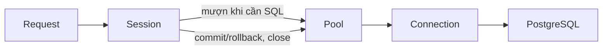
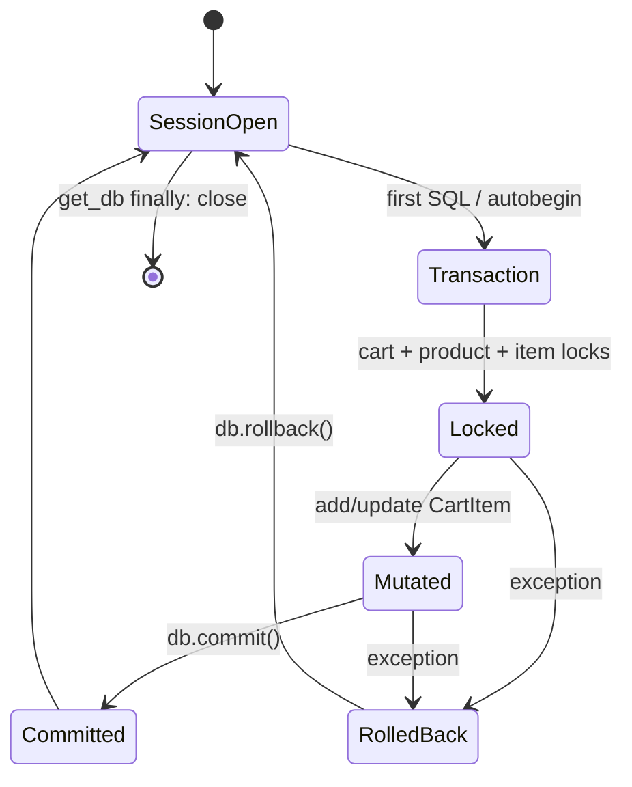
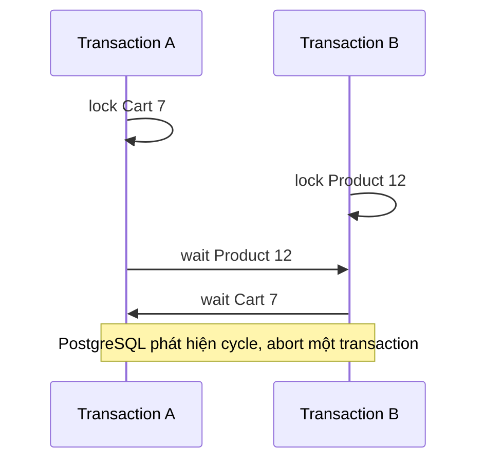
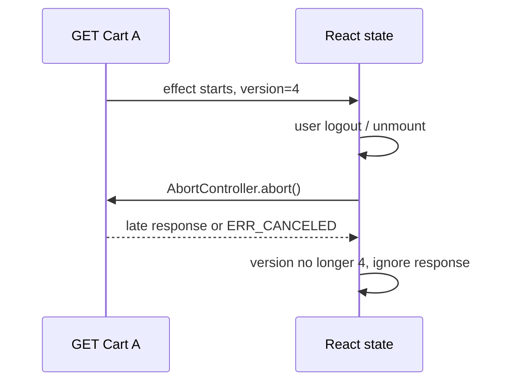

# Phase 11 — Shopping Cart: từ click React đến transaction PostgreSQL

> Phạm vi tài liệu này là implementation đang có trên branch Phase 11. Những
> đoạn được ghi **minh họa** không phải source đang chạy. Những phần ghi **thay
> thế** là lựa chọn kiến trúc để so sánh, chưa được thêm vào dự án.

## Mục lục

- [1. Bản đồ implementation](#1-bản-đồ-implementation)
- [2. Luồng end-to-end](#2-luồng-end-to-end)
- [3. Thiết kế database](#3-thiết-kế-database)
- [4. SQLAlchemy ORM và relationship](#4-sqlalchemy-orm-và-relationship)
- [5. Session, connection và transaction](#5-session-connection-và-transaction)
- [6. Relationship loading và N+1](#6-relationship-loading-và-n1)
- [7. ACID, MVCC và isolation](#7-acid-mvcc-và-isolation)
- [8. Row lock, race condition và lost update](#8-row-lock-race-condition-và-lost-update)
- [9. UPSERT, atomic update và deadlock](#9-upsert-atomic-update-và-deadlock)
- [10. FastAPI, auth và CSRF](#10-fastapi-auth-và-csrf)
- [11. React, Context và state bất đồng bộ](#11-react-context-và-state-bất-đồng-bộ)
- [12. API contract và trạng thái UI](#12-api-contract-và-trạng-thái-ui)
- [13. Đọc source cùng nhau](#13-đọc-source-cùng-nhau)
- [14. Debugging thực tế](#14-debugging-thực-tế)
- [15. Chiến lược kiểm thử](#15-chiến-lược-kiểm-thử)
- [16. Bài tập thực hành](#16-bài-tập-thực-hành)
- [17. Kiến thức nâng cao cho Phase 12](#17-kiến-thức-nâng-cao-cho-phase-12)
- [18. Hiểu lầm thường gặp](#18-hiểu-lầm-thường-gặp)
- [19. Glossary](#19-glossary)

## 1. Bản đồ implementation

### Vấn đề thực tế

Cart trông như chỉ là “lưu product ID và quantity”. Nhưng khi hai tab cùng bấm
thêm, khi stock thay đổi, khi user logout giữa một request, hoặc khi Product bị
xóa, dữ liệu rất dễ sai nếu trách nhiệm bị đặt sai layer.

### Đang triển khai

| Layer | File thực tế | Trách nhiệm |
| --- | --- | --- |
| Schema DB | `backend/app/models/cart.py` | Khai báo `Cart`, `CartItem`, relationship ORM. |
| Migration | `backend/migrations/versions/20261024_05_create_carts.py` | Tạo bảng, FK, unique/check constraints thật trong PostgreSQL. |
| DTO | `backend/app/schemas/cart.py` | Validate payload và định nghĩa response Pydantic. |
| Nghiệp vụ | `backend/app/services/cart.py` | Lock, stock validation, commit/rollback, xây response. |
| HTTP | `backend/app/api/v1/endpoints/cart.py` | Route, dependency, HTTP status. |
| Auth | `backend/app/core/security.py` | Access JWT, Redis session, blacklist, CSRF/Origin. |
| API client | `frontend/src/api/cart.ts` | Gọi đúng năm endpoint. |
| Shared state | `frontend/src/cart/CartContext.tsx` | Snapshot cart cho header/card/detail/page. |
| UI | `StorefrontShell`, `StoreProductCard`, `StorefrontProductPage`, `CartPage` | Render, disable pending, toast, điều hướng. |

Backend là **source of truth**: PostgreSQL giữ cart, stock và price hiện tại.
React chỉ giữ một snapshot để render nhanh trong tab đang mở. Vì vậy không có
`localStorage` cart và frontend không bao giờ gửi price/subtotal để backend tin.

### Tự kiểm tra

1. Nếu refresh browser, source nào quyết định quantity còn lại?
2. Nếu React tự cộng subtotal mà không hỏi backend, giá Product đổi sẽ xảy ra gì?

## 2. Luồng end-to-end

### A. Khi user bấm “Thêm vào giỏ”

```mermaid
sequenceDiagram
    actor U as User
    participant Card as StoreProductCard / Detail
    participant Ctx as CartContext
    participant AX as Axios client
    participant R as FastAPI cart router
    participant D as Depends: user + CSRF + db
    participant S as cart service
    participant PG as PostgreSQL
    participant H as StorefrontShell badge

    U->>Card: click Add, quantity
    Card->>Ctx: addItem(productId, quantity)
    Ctx->>AX: POST /api/v1/cart/items
    AX->>AX: Cookie + X-CSRF-Token; retry one 401 refresh
    AX->>R: HTTP request
    R->>D: get_current_user, require_csrf, get_db
    D->>R: User + Session
    R->>S: add_item(db, user, payload)
    S->>PG: INSERT ON CONFLICT; SELECT FOR UPDATE; COMMIT
    PG-->>S: durable cart state
    S-->>R: CartResponse
    R-->>AX: 201 JSON
    AX-->>Ctx: response.data
    Ctx-->>Card: state re-render
    Ctx-->>H: total_quantity re-render
```

1. `StoreProductCard` và `StorefrontProductPage` không biết SQL. Chúng kiểm tra
   user, disable nút khi pending, rồi gọi `addItem`.
2. `CartContext` gọi `addCartItem()` từ `frontend/src/api/cart.ts`.
3. `frontend/src/api/client.ts` đã có `withCredentials: true`, vì access/refresh
   token là HttpOnly cookies. Interceptor thêm CSRF header cho mutation.
4. Router không nhận `user_id` từ JSON. `get_current_user` suy user từ JWT +
   Redis session, nên client không thể chọn cart của người khác bằng body.
5. Service là business layer: tạo/lock Cart, lock Product, kiểm stock, mutate,
   commit/rollback. Router chỉ chuyển HTTP thành lời gọi service.
6. Response Pydantic được serialize thành JSON. Decimal hiện thành JSON string,
   nên TypeScript khai báo `unit_price`, `line_total`, `subtotal` là `string`.
7. Context thay snapshot bằng response; header đọc `cart.total_quantity` nên badge
   đổi mà không cần prop drilling.

### So sánh NestJS

FastAPI `APIRouter` gần Controller, `Depends` gần Guard/Pipe/DI theo từng
parameter, Pydantic schema gần DTO + ValidationPipe, service gần Nest Service.
Không có Repository layer riêng ở Cart: service dùng SQLAlchemy Session trực tiếp.
Điều này hợp lý khi query còn gọn; khi nhiều aggregate phức tạp, repository có
thể giúp, nhưng chưa cần thêm ở Phase 11.

## 3. Thiết kế database

### ERD đang triển khai

```mermaid
erDiagram
    USERS ||--o| CARTS : owns
    CARTS ||--o{ CART_ITEMS : contains
    PRODUCTS ||--o{ CART_ITEMS : appears_in

    USERS {
      int id PK
      varchar email UK
    }
    PRODUCTS {
      int id PK
      numeric price
      int stock
    }
    CARTS {
      int id PK
      int user_id FK_UK
      timestamptz created_at
      timestamptz updated_at
    }
    CART_ITEMS {
      int id PK
      int cart_id FK
      int product_id FK
      int quantity
    }
```

### A. Tại sao có `carts` và `cart_items`?

Một User có tối đa một Cart: `carts.user_id` là FK đến `users.id` và có
`UNIQUE(user_id)`. Một Cart có nhiều item. Một Product xuất hiện trong Cart của
nhiều user. Đây là many-to-many có thuộc tính `quantity`, nên cần entity trung
gian `cart_items`; mảng `[1, 4, 9]` trong cột Cart không mô tả được quantity,
không FK được từng Product, không unique được một product/cart, và query/index
khó hơn.

Price **không** được lưu trong `CartItem` tại Phase 11. `_cart_response()` đọc
`item.product.price` để phản ánh giá hiện tại. Đây là chủ ý: cart chưa phải
order. Khi checkout ở phase sau, cần quyết định price snapshot trong OrderItem
và revalidate trên server.

### B. Constraints thật trong migration

`20261024_05_create_carts.py` tạo:

| Constraint | Bảo vệ điều gì | Nếu bỏ |
| --- | --- | --- |
| `carts.user_id -> users.id ON DELETE CASCADE` | Không còn cart khi user bị xóa. | Có Cart mồ côi. |
| `UNIQUE(carts.user_id)` | Một cart/user, kể cả concurrent create. | Hai tab có thể tạo hai Cart. |
| `cart_items.cart_id -> carts.id ON DELETE CASCADE` | Xóa Cart xóa item. | Item trỏ Cart mất. |
| `cart_items.product_id -> products.id ON DELETE CASCADE` | Hard-delete Product không để CartItem mồ côi. | Cart chứa Product không còn. |
| `UNIQUE(cart_id, product_id)` | Một dòng cho một Product trong một Cart. | Hai dòng cùng product, subtotal khó đúng. |
| `CHECK(quantity > 0)` | DB từ chối 0/âm dù bypass API. | Dữ liệu vô nghĩa. |

PostgreSQL tạo index cho primary key và unique constraint để enforce uniqueness;
migration không tạo index suy đoán khác. FK không phải lúc nào cũng tự tạo index
ở PostgreSQL, vì vậy khi Cart rất lớn cần đo query plan trước khi thêm index.

### Tự kiểm tra

1. `UNIQUE(cart_id, product_id)` có tự cộng quantity không? Không; nó chỉ cấm
   duplicate. Service vẫn phải quyết định cộng như thế nào.
2. Cascade có nghĩa API được phép xóa Product tùy ý không? Không; RBAC/business
   policy vẫn quyết định được gọi delete hay không.

## 4. SQLAlchemy ORM và relationship

### A. ORM là gì?

ORM ánh xạ row SQL thành object Python. `Cart` là class Python; `carts` là table
PostgreSQL. ORM giảm code chuyển dữ liệu, nhưng SQL và constraint vẫn là thứ
database thực thi. SQLAlchemy còn có Core (`select`, `insert`, `delete`) để xây
SQL expression; project dùng cả ORM model lẫn Core-style `select()`.

`backend/app/db/base.py` cung cấp `Base`; model kế thừa `Base` để SQLAlchemy biết
metadata/table mapping. Type annotation hiện đại:

```python
# backend/app/models/cart.py — đang triển khai
id: Mapped[int] = mapped_column(primary_key=True)
user_id: Mapped[int] = mapped_column(
    ForeignKey("users.id", ondelete="CASCADE"), unique=True, nullable=False
)
```

- `Mapped[int]`: attribute ORM, không chỉ type hint thông thường.
- `mapped_column(...)`: định nghĩa cột SQL.
- `nullable=False`: DB không nhận NULL.
- `ForeignKey(...)`: DB-level referential integrity.
- `CheckConstraint`/`UniqueConstraint`: rule chạy trong PostgreSQL, không phải
  validation UI.

`Index(...)` là metadata để tạo index truy vấn; Cart model hiện **không** gọi
`Index()` explicit. Primary key và unique constraint vẫn được PostgreSQL index
hóa để enforce chúng. Không thêm index `product_id` hoặc composite index chỉ vì
đoán; cần xem query plan/`EXPLAIN ANALYZE` khi dữ liệu đủ lớn.

### B. Foreign key khác `relationship()`

Foreign key là rule/schema trong DB. `relationship()` là instruction cho ORM về
cách nối object. Trong source:

```python
# backend/app/models/cart.py — đang triển khai
user: Mapped["User"] = relationship(back_populates="cart")
items: Mapped[list["CartItem"]] = relationship(
    back_populates="cart", passive_deletes=True
)
```

`cart.user_id` là integer FK. `cart.user` là Python `User` object. PostgreSQL
không biết hay cần `relationship()`. Nếu chỉ có FK, service vẫn query thủ công:

```python
# minh họa, không phải implementation
items = db.scalars(select(CartItem).where(CartItem.cart_id == cart.id)).all()
```

Relationship làm `cart.items` tiện hơn, mô tả navigation hai chiều qua
`back_populates`: `Cart.items <-> CartItem.cart`, `Product.cart_items <->
CartItem.product`, `User.cart <-> Cart.user`.

`passive_deletes=True` nói ORM đừng tự tải children để xóa từng object khi parent
bị xóa; hãy để `ON DELETE CASCADE` database làm. Nó **không tự tạo cascade**;
migration FK mới là thứ tạo cascade thật.

### C. So sánh framework

| Khái niệm | SQLAlchemy | TypeORM/JPA | Prisma |
| --- | --- | --- | --- |
| Entity | `class Cart(Base)` | `@Entity()` / `@Entity` | `model Cart` |
| Column | `mapped_column()` | `@Column` / `@Column` | field |
| FK | `ForeignKey()` | `@JoinColumn`/mapping | relation scalar field |
| Object navigation | `relationship()` | `@OneToMany`, `@ManyToOne` | generated relation field |
| Load strategy | `selectinload`, `joinedload` | relation options/eager | `include`, `select` |

Không framework nào thay FK/constraint database. TypeORM decorator hay Prisma
schema cũng chỉ mô tả và/hoặc generate SQL; database mới là enforcement cuối.

### D. Khi nào dùng relationship?

Dùng khi object graph rõ ràng và code hay cần đi từ parent sang child. Tránh
lạm dụng `cart.items` ngầm trong loop lớn nếu không kiểm soát loading strategy.
Với reporting phẳng, aggregate lớn, hoặc chỉ cần vài column, `select()` explicit
có thể rõ và ít tải dữ liệu hơn.

## 5. Session, connection và transaction

### A. Session không phải connection

`get_db()` trong `backend/app/db/database.py` tạo một `Session` cho mỗi request:

```python
def get_db() -> Generator[Session, None, None]:
    session = get_session_factory()()
    try:
        yield session
    except Exception:
        session.rollback()
        raise
    finally:
        session.close()
```

Session là workspace ORM: identity map, unit of work, transaction state. Nó lấy
connection từ pool khi cần SQL, rồi trả connection theo lifecycle transaction/
close. Session không nên share giữa concurrent requests: identity map và pending
changes của request A có thể lẫn request B.

`get_session_factory()` tạo engine với `pool_size`, `max_overflow`, `pool_pre_ping`
từ Settings. Engine quản lý connection pool; connection là socket/DB session thật;
Session là wrapper cấp ORM dùng connection đó khi thực thi.



### B. Identity map và Unit of Work

Trong một Session, `db.get(Product, 5)` có thể trả lại cùng Python object nếu
Product 5 đã được load. Đây là identity map, không cam kết “không bao giờ query”;
expire, query khác, transaction boundary và loader option ảnh hưởng kết quả.

Unit of Work theo dõi object thay đổi. `item.quantity = quantity` chưa chắc gửi
SQL ngay; khi flush/commit, ORM tính `INSERT/UPDATE/DELETE` cần thiết.

| State | Ví dụ | Ý nghĩa |
| --- | --- | --- |
| transient | `CartItem(...)` mới tạo | Chưa thuộc Session/DB. |
| pending | sau `db.add(item)` | Session sẽ INSERT khi flush. |
| persistent | sau flush/load | Có identity database trong Session. |
| detached | Session close | Object còn Python nhưng không còn managed. |

### C. `add`, `flush`, `commit`, `rollback`, `refresh`

| Lệnh | Làm gì | Có SQL? | Commit? |
| --- | --- | --- | --- |
| `db.add(obj)` | Đưa transient object vào Unit of Work. | Chưa bắt buộc. | Không. |
| `db.flush()` | Đồng bộ pending changes xuống DB trong transaction hiện tại. | Thường INSERT/UPDATE/DELETE. | Không. |
| `db.commit()` | Flush nếu cần rồi COMMIT. | Có thể flush + COMMIT. | Có. |
| `db.rollback()` | Hủy transaction hiện tại, Session dùng được lại. | ROLLBACK nếu transaction đã mở. | Không. |
| `db.refresh(obj)` | Re-load row vào object. | SELECT. | Không. |

Ví dụ thật ở `tests/test_cart.py:create_product()` gọi `db.flush()` sau khi thêm
Category để có `category.id` trước khi tạo Product. `flush()` không làm data bền:
nếu `commit()` sau đó lỗi, Category cũng rollback.

SQLAlchemy 2.x có autobegin: SQL đầu tiên bắt đầu transaction khi cần, thay vì
API `autocommit=True` kiểu cũ. Factory project đặt `autoflush=False`; nghĩa là
query không tự flush mọi pending change. Service gọi `commit()` rõ ràng để giảm
bất ngờ và giữ transaction boundary dễ đọc.

### D. Vòng đời `add_item`



`add_item()` bao `commit()` trong `try/except`; mọi exception gọi `db.rollback()`
trước khi re-raise. Điều này rất quan trọng: sau lỗi DB, Session ở failed
transaction state; query tiếp theo trước rollback có thể lỗi tiếp và che nguyên
nhân gốc.

## 6. Relationship loading và N+1

### Vấn đề

Nếu `cart.items` lazy-load, lần truy cập đầu có thể SELECT items. Sau đó mỗi
`item.product` có thể cần SELECT Product riêng. Với 10 item khác Product, đó là
mẫu N+1: một query parent/items, rồi N query child. Nó tăng round trip và giữ
connection lâu hơn.

Implementation thật chủ động load:

```python
# backend/app/services/cart.py:get_cart
cart = db.scalar(
    select(Cart)
    .where(Cart.user_id == user.id)
    .options(selectinload(Cart.items).selectinload(CartItem.product))
)
```

`selectinload` thường phát một query Cart, một query CartItem theo list cart id,
và một query Product theo list product id. Đây là mô tả strategy, không phải lời
khẳng định số query tuyệt đối: cần SQL logging/profiling để đếm chính xác trong
phiên bản SQLAlchemy/database cụ thể.

`joinedload` là thay thế dùng JOIN trong query parent. Nó có thể tốt cho relation
một-nhỏ-một; với collection lớn, row Cart bị lặp cho mỗi item và kết quả phình.
`selectinload` thường dễ dự đoán cho Cart -> many items -> Product.

Identity map có thể tránh load lại cùng primary key trong **cùng Session**, nhưng
không nên dùng nó như chiến lược N+1: request mới có Session mới, và access
pattern vẫn không rõ ràng.

### Tự kiểm tra

1. `relationship()` tự động bảo đảm không N+1 không? Không.
2. Vì sao `_cart_response()` an toàn hơn sau `selectinload`? Vì `item.product`
   đã được load theo strategy khai báo.

## 7. ACID, MVCC và isolation

### ACID trong Cart

- **Atomicity:** add item hoặc hoàn tất commit, hoặc rollback toàn bộ; không có
  Cart mới nhưng CartItem nửa chừng.
- **Consistency:** FK/unique/check và `_assert_stock()` giữ invariant. Constraint
  DB bảo vệ kể cả script/API khác; service bảo vệ stock rule nghiệp vụ.
- **Isolation:** transaction đồng thời không được nhìn/update row lock theo cách
  làm mất quantity. Đây cần lock, không chỉ cần transaction.
- **Durability:** sau COMMIT PostgreSQL đảm bảo thay đổi theo durability policy
  của server; process web chết sau response không nên làm commit biến mất.

PostgreSQL dùng MVCC: row version để reader thường không chặn writer và ngược lại
trong nhiều trường hợp. `SELECT` thông thường không lock row của `FOR UPDATE`.
Project không đặt isolation level explicit trong `create_engine`, nên source không
khẳng định hơn mức: PostgreSQL default thông thường là `READ COMMITTED`. Hãy kiểm
tra `SHOW transaction_isolation;` trên môi trường cụ thể nếu cần chứng minh.

Ở READ COMMITTED, mỗi statement thấy snapshot committed mới tại lúc statement
bắt đầu. Dirty read không xảy ra trong PostgreSQL READ COMMITTED. Non-repeatable
read và phantom có thể xảy ra nếu transaction chạy nhiều SELECT thường; code Cart
khóa các row quan trọng cho mutation thay vì kỳ vọng snapshot cô lập mọi thứ.

## 8. Row lock, race condition và lost update

### A. `SELECT ... FOR UPDATE` thực sự làm gì?

`with_for_update()` trong SQLAlchemy sinh ý nghĩa SQL tương đương:

```sql
SELECT * FROM carts WHERE user_id = $1 FOR UPDATE;
SELECT * FROM products WHERE id = $1 FOR UPDATE;
```

Nó khóa **row được chọn**, giữ đến COMMIT/ROLLBACK. Transaction thứ hai muốn
`FOR UPDATE` hoặc update/delete cùng row thường chờ, chứ không khóa toàn table.
SELECT bình thường vẫn có thể đọc committed version theo MVCC.

Source theo thứ tự trong `add_item()`:

1. `_locked_cart()` UPSERT cart rồi `FOR UPDATE` Cart của user.
2. `_locked_product()` `FOR UPDATE` Product.
3. Query `CartItem` của cặp `(cart_id, product_id)` với `FOR UPDATE`.
4. Cộng quantity, check stock, mutate, commit.

Cart lock serialize mutation cho cùng user Cart. Product lock serialize stock
validation với mutation Cart khác cùng Product. Hai loại lock giải hai vấn đề
khác nhau.

### B. Lost update: không lock vs có lock

Giả sử quantity hiện là 1, A và B cùng add 1.

| Thời điểm | Không lock | Có CartItem lock |
| --- | --- | --- |
| T1 | A đọc 1 | A lock, đọc 1 |
| T2 | B đọc 1 | B chờ lock |
| T3 | A ghi 2 | A ghi 2, commit |
| T4 | B ghi 2 | B lock, đọc 2 |
| Kết quả | **2, mất một add** | B ghi 3 |

Điểm quan trọng: Python `item.quantity += 1` không atomic qua hai transaction;
nó là read-modify-write. Lock biến đoạn đọc + kiểm + ghi thành critical section
trong PostgreSQL.

### C. Race Product thay đổi/xóa

`_locked_product()` lock Product trước check stock. Nếu admin update stock cần
lock cùng Product, một bên chờ bên kia thay vì check một stock cũ rồi commit mù.
Nếu Product bị delete cạnh tranh với add, test chấp nhận add `201` hoặc `404`,
nhưng cuối cùng FK cascade phải để `CartItem` count bằng 0. Đây là invariant hậu
cùng, không hứa kết quả timing cố định cho request add.

## 9. UPSERT, atomic update và deadlock

### A. UPSERT tạo Cart

Source dùng dialect PostgreSQL:

```python
# backend/app/services/cart.py:_locked_cart
db.execute(
    insert(Cart).values(user_id=user_id)
    .on_conflict_do_nothing(index_elements=[Cart.user_id])
)
cart = db.scalar(select(Cart).where(Cart.user_id == user_id).with_for_update())
```

Nó tương đương gần đúng:

```sql
INSERT INTO carts (user_id) VALUES ($1)
ON CONFLICT (user_id) DO NOTHING;
SELECT * FROM carts WHERE user_id = $1 FOR UPDATE;
```

Nếu A và B cùng tạo Cart, unique index là arbiter: chỉ một INSERT tạo row; bên
còn lại không nổ `IntegrityError`, rồi lock/read row chung. Check-then-insert
(`SELECT` trước, rồi `INSERT`) không an toàn vì cả hai có thể cùng thấy “chưa có”.

`ON CONFLICT DO UPDATE` là biến thể khác, ví dụ **minh họa**:

```sql
INSERT INTO cart_items (cart_id, product_id, quantity)
VALUES ($1, $2, 1)
ON CONFLICT (cart_id, product_id)
DO UPDATE SET quantity = cart_items.quantity + EXCLUDED.quantity;
```

Project không dùng nó cho CartItem vì còn phải lock/read Product và validate tổng
quantity với stock. Một SQL ngắn không tự giải quyết business invariant đó.

### B. Bốn lựa chọn cập nhật quantity

| Cách | Điểm mạnh | Rủi ro/giới hạn |
| --- | --- | --- |
| Read-modify-write không lock | Dễ viết. | Lost update. |
| Read + `FOR UPDATE` (đang dùng) | Logic stock rõ, row được serialize. | Nhiều query và contention cùng cart/product. |
| `UPDATE quantity = quantity + 1` | Atomic increment, ít round trip. | Cần điều kiện stock/returning cẩn thận. |
| CartItem UPSERT | Gộp insert/cộng. | Phức tạp khi validate stock và lock ordering. |

**Thay thế minh họa:** atomic SQL có thể viết `UPDATE ... SET quantity =
quantity + $delta WHERE ... RETURNING quantity`, nhưng khi quantity chưa có row
vẫn cần insert/upsert. Với catalog học tập, `FOR UPDATE` dễ audit hơn.

### C. Deadlock và lock ordering

Deadlock không phải chờ bình thường. Nó xảy ra khi A giữ Cart chờ Product, B giữ
Product chờ Cart:



PostgreSQL phát hiện cycle, chọn một victim, rollback victim và trả error. Không
thể biết trước transaction nào bị chọn. Rule là giữ lock order nhất quán: Cart
rồi Product rồi CartItem trong Cart mutation. Test hiện có race add/delete để
phát hiện hang/orphan, nhưng **không chứng minh tuyệt đối** mọi Product admin
service tuân thủ cùng order. Retry deadlock chỉ nên có khi operation idempotent
hoặc caller có idempotency key; retry mù có thể add quantity hai lần.

## 10. FastAPI, auth và CSRF

### Endpoint từ đầu đến cuối

```python
# backend/app/api/v1/endpoints/cart.py — đang triển khai
@router.post("/items", response_model=CartResponse, status_code=status.HTTP_201_CREATED)
def add_item(
    payload: CartItemCreate,
    current_user: User = Depends(get_current_user),
    db: Session = Depends(get_db),
    _: None = Depends(require_csrf),
) -> CartResponse:
    return cart_service.add_item(db, current_user, payload)
```

FastAPI parse JSON vào `CartItemCreate` (`product_id > 0`, `quantity > 0`) trước
khi handler chạy. Payload sai type/0/âm thành 422. `Depends` resolve User, Session
và CSRF. Đây là sync function; FastAPI/Starlette chạy sync endpoint trong worker
thread, nên không block event loop bằng SQLAlchemy sync Session.

`response_model=CartResponse` validate/serialize output. Không trả ORM Cart trực
tiếp, nên contract chỉ có fields UI cần. Status: GET/PATCH 200; POST 201; DELETE
204 không body; missing auth 401; CSRF/Origin fail 403; no Product/item 404;
stock conflict 409; Pydantic 422; Redis auth unavailable 503.

### Authentication, authorization, CSRF, CORS

| Cơ chế | Câu hỏi trả lời | Cart dùng thế nào |
| --- | --- | --- |
| Authentication | “Ai gọi?” | Access JWT + Redis session trong `get_current_user`. |
| Authorization | “Người đó được làm gì?” | Cart luôn của `current_user`; không có `user_id` client. |
| CSRF | “Browser có bị site khác ép gửi cookie không?” | `require_csrf` check header/cookie/session token + Origin. |
| CORS | “Browser có cho origin gọi API không?” | Middleware CORS kiểm origin cross-origin; không thay CSRF. |

`get_current_user()` verify signature/claims/JTI blacklist, đọc Redis session,
so `session['user_id']` với JWT `sub`, rồi load active User. Redis lỗi trả 503
(fail closed), không coi token là hợp lệ. `require_csrf()` gọi `_origin_allowed`,
verify access/session, sau đó `hmac.compare_digest` header với cookie và Redis
session CSRF. `SameSite=Lax` giúp giảm một phần cross-site behavior nhưng không
thay CSRF token cho mutation cookie-based.

**Request hợp lệ:** cookie access được browser gửi, Axios đọc CSRF cookie không
HttpOnly và set `X-CSRF-Token`; Origin nằm trong allow-list; JWT/session hợp lệ.
**Request bị chặn:** thiếu header hoặc header khác Redis `csrf` -> 403; JWT
blacklist/revoked session -> 401; Redis unavailable -> 503.

## 11. React, Context và state bất đồng bộ

### A. Render/effect/cleanup

React gọi function component để render UI. `useState` update làm re-render.
`useEffect` chạy sau render; return của effect là cleanup, chạy trước effect mới
hoặc khi unmount. Development Strict Mode có thể mount/effect/cleanup thêm một
vòng để lộ side effect không an toàn, nên không được giả định effect chỉ chạy một
lần trong dev.

`CartProvider` nằm trong `AuthProvider` ở `frontend/src/App.tsx`; vì vậy nó đọc
`user` và `authLoading`. Khi `user` đổi, effect reset snapshot và tải cart mới:

```tsx
// frontend/src/cart/CartContext.tsx — rút gọn từ source thật
useEffect(() => {
  const version = ++requestVersion.current;
  activeUserId.current = user?.id ?? null;
  setCart(emptyCart);
  if (authLoading || !user) return;
  const controller = new AbortController();
  void cartApi.getCart(controller.signal).then((response) => {
    if (requestVersion.current === version) setCart(response.data);
  });
  return () => controller.abort();
}, [authLoading, user]);
```

`AbortController` yêu cầu Axios hủy request khi component/user effect cleanup.
`requestVersion` là counter trong `useRef`; ref không làm re-render nhưng giữ giá
trị giữa render. Nếu response cũ về sau cleanup, version không khớp nên nó không
ghi Cart của A lên UI B. Cần cả hai: abort là yêu cầu hủy, nhưng network/Promise
có thể đã resolve đúng lúc; version kiểm response là lớp bảo vệ state.

### B. Stale closure

Closure là function giữ giá trị của render lúc nó được tạo. `refresh` capture
`user`; source lấy `userId`, rồi chỉ `setCart` nếu `activeUserId.current` còn
trùng. Điều này tránh response của user cũ overwrite user mới trong case chính.

**Rủi ro đang có:** mutation concurrent từ nhiều component không có mutation
version/queue ở frontend. Hai response mutation có thể về khác thứ tự; backend
serialize và trả trạng thái đúng theo từng transaction, nhưng UI có thể tạm thời
nhận snapshot cũ hơn snapshot mutation sau. Các button riêng lẻ disable pending,
nhưng không global-lock mọi Cart action. Đây là tradeoff chấp nhận được ở phase
hiện tại; nếu UX cần mạnh hơn, dùng mutation sequence/refetch sau mutation hoặc
cache library có mutation ordering—không tự thêm ở source hiện tại.

### C. Context không phải server cache

Context chỉ publish value xuống consumer. Mỗi lần Provider `value` đổi, consumer
dùng `useCart()` re-render. Nó giải props drilling giữa Header/Card/Page, nhưng
không tự cache, deduplicate request, cancel request hay xử lý race. Vì Auth và
Cart có lifecycle khác, tách `AuthContext` và `CartContext` tốt hơn một global
object lớn. Với cache/invalidation/pagination phức tạp, TanStack Query; với state
app client phức tạp, Zustand/Redux có thể phù hợp—đó là **thay thế**, chưa dùng.

### D. Ba timeline quan trọng



1. **Unmount khi GET:** cleanup abort; canceled error bị nhận diện bằng
   `ERR_CANCELED`, không hiển thị toast lỗi.
2. **A logout, B login:** effect tăng version, reset `emptyCart`, set active ID
   B; response A fail guard nên không lộ cart A cho B.
3. **GET cũ và POST add:** POST response set cart. Nếu GET cũ thuộc cùng version
   bắt đầu trước POST, source hiện tại không tăng `requestVersion` khi mutation;
   GET cũ có thể overwrite POST response nếu về sau. Đây là rủi ro vừa nêu, không
   bị AbortController giải quyết vì component vẫn mounted.

## 12. API contract và trạng thái UI

### Axios

`frontend/src/api/client.ts` dùng `baseURL = VITE_API_URL`, timeout 8 giây và
`withCredentials: true`. Request interceptor thêm CSRF header cho POST/PUT/PATCH/
DELETE. Response interceptor chỉ refresh khi 401, request chưa `_retried`, và URL
không thuộc `/auth/`; `refreshRequest` singleton làm nhiều request 401 cùng chờ
một refresh, tránh refresh storm. Mỗi original request retry tối đa một lần.

`frontend/src/api/cart.ts` khớp backend chính xác: GET, POST items, PATCH item,
DELETE item, DELETE cart. `Cart` TypeScript trong `types/catalog.ts` dùng string
cho money vì JSON Pydantic Decimal không phải JavaScript Decimal.

HTTP status Cart đang dùng: 200 (GET/PATCH), 201 (POST), 204 (DELETE), 401
(không xác thực/revoked), 403 (CSRF/Origin), 404 (Product hoặc CartItem không
tồn tại), 409 (vượt stock), 422 (payload Pydantic sai), 503 (Redis auth không
sẵn sàng). `400 Bad Request` là status HTTP hợp lệ nhưng không phải nhánh Cart
được implementation hiện tại khai báo; đừng tài liệu hóa nó như behavior thật.

### UI state đang có

| Action | Context/UI thực hiện |
| --- | --- |
| Login/reload | Auth khôi phục user, Cart effect GET cart. |
| Add | POST trả `Cart`, Context thay state, badge tăng. |
| Update | PATCH trả `Cart`, Context thay state. |
| Remove | DELETE 204, Context `refresh()` vì body rỗng. |
| Clear | DELETE 204, Context set `emptyCart`. |
| Logout | Auth set user null, Cart effect reset empty. |
| Stock giảm | API response có `is_available=false`, `CartPage` cảnh báo. |

`StoreProductCard`/detail redirect guest đến `/login` với return location. Login
cho USER dùng safe public return path. `CartPage` có loading, empty, error retry;
quantity controls disable khi pending/hết stock; icon delete có accessible label.

Optimistic update nghĩa đổi UI trước server và rollback nếu lỗi. Source hiện tại
là pessimistic/server-confirmed update: chờ response trước khi đổi cart. Chậm hơn
một nhịp nhưng dễ đúng với stock/concurrency. DELETE 204 là lý do remove refetch;
không được gọi `.data` từ response 204 rồi giả sử Cart mới tồn tại.

## 13. Đọc source cùng nhau

### `backend/app/models/cart.py`

**Ai dùng:** Alembic metadata, service, tests. **Input/output:** mapping Python
object <-> row. **Nếu bỏ:** không có table mapping/relationship để query Cart.

Điểm đọc chính: `Cart.user_id unique=True` là one-to-one; `CartItem` là link có
quantity; `utc_now` tạo timestamp timezone-aware. Alternative là raw SQL/data
class, nhưng mất Unit of Work/navigation ORM và tăng mapping thủ công.

### `backend/migrations/versions/20261024_05_create_carts.py`

Migration là lịch sử schema có thể chạy trên dev/test/prod. Nó không gọi
`Base.metadata.create_all()`, nên môi trường đã tồn tại tiến dần từ revision cũ.
Nếu bỏ migration mà chỉ thêm model, app query `carts` sẽ gặp `UndefinedTable`/
`relation "carts" does not exist`; đó chính là lỗi runtime khi database dev chưa
upgrade. Chạy `alembic upgrade head`, không tạo lại database.

### `backend/app/schemas/cart.py`

`CartItemCreate` và `CartItemUpdate` dùng `Field(gt=0)`, chặn input xấu tại HTTP
boundary. `CartItemResponse` chủ ý gồm price/stock derived từ Product; source
không có `cart_item_id` endpoint—PATCH/DELETE dùng `product_id` cùng cart user.
Pydantic không thay DB CHECK: script direct DB vẫn cần DB constraint.

### `backend/app/services/cart.py`

Đây là nơi đọc nhất: `_locked_cart`, `_locked_product`, `_assert_stock`,
`add_item`, `update_item`, `remove_item`, `clear_cart`. Service commit một lần
trong mỗi mutation thành công; rollback rõ trong exception path của add/update.
Nếu đưa logic này vào router, HTTP/auth/business/transaction sẽ trộn khó test.

### `backend/app/api/v1/endpoints/cart.py`

Router đặt prefix `/cart`, được `backend/app/api/v1/router.py` include dưới
`/api/v1`. Nó chuyển request thành `CartItemCreate`, inject Session/User/CSRF,
gọi service, chọn HTTP 201/204. Nó không tạo Session mới ngoài `get_db`.

### `backend/tests/test_cart.py`

File dùng fixture API/auth thật từ `tests/test_auth.py`, PostgreSQL test database
và Redis DB 15. `concurrent_add()` copy auth/CSRF cookies vào `TestClient` riêng,
dùng `Barrier` để hai worker đến điểm request gần nhau, ThreadPool + timeout để
test không treo vô hạn.

Các test hiện có: CRUD/price/stock/persistence; validation/isolation/cascade;
security blacklist/revoke/Redis failure; concurrent cart creation + existing
item add; near-stock + different products; product delete race. Lần verification
Phase 11 đã chạy 6 Cart tests PASS và full backend suite 52 PASS. Điều đó là
bằng chứng regression thời điểm chạy, không phải chứng minh concurrency tuyệt đối
cho mọi workload/production topology.

### Frontend files

| File | Vai trò | Sai lầm hay gặp |
| --- | --- | --- |
| `api/cart.ts` | Contract Axios typed. | Gửi `price` hoặc tạo Axios riêng không CSRF. |
| `cart/CartContext.tsx` | Shared snapshot + lifecycle. | Đặt cart vào localStorage hoặc quên reset user. |
| `StoreProductCard.tsx` | Add một item, redirect guest. | Allow double click/pending. |
| `StorefrontProductPage.tsx` | Selector max theo stock API. | Tin stock cũ như validation cuối. |
| `CartPage.tsx` | Render total/line/remove/clear. | Đọc body DELETE 204. |
| `StorefrontShell.tsx` | Link/badge/menu user. | Fetch cart cho guest lặp vô ích. |
| `App.tsx` | Bọc `CartProvider` trong `AuthProvider`, route `/cart`. | Đảo Provider làm `useAuth` không dùng được. |

## 14. Debugging thực tế

Đi theo một hướng, không đoán:

1. **Browser Network:** POST path/body/status, cookies sent, `X-CSRF-Token`.
2. **FastAPI logs:** request ID/path/status; không log JWT/refresh/password.
3. **Service:** breakpoint/log lock/stock path, không log secret.
4. **PostgreSQL:** transaction/query/constraint; `alembic current` kiểm schema.

| Triệu chứng | Kiểm tra trước | Nguyên nhân phổ biến | Hướng xử lý |
| --- | --- | --- | --- |
| Add 401 | Network cookie + `/auth/me` | access expired/revoked/session mất | kiểm refresh, login lại. |
| Add 403 | Header Origin/CSRF | thiếu/sai CSRF hoặc Origin lạ | dùng Axios client chung; kiểm `CORS_ORIGINS`. |
| Add 409 | response detail, Product stock | quantity vượt stock | reload Product/cart, giảm quantity. |
| Add 422 | JSON body | 0/âm/string quantity | gửi integer > 0. |
| API 500 `carts` missing | `alembic current` | DB chưa upgrade migration 05 | `alembic upgrade head`. |
| Badge không đổi | CartContext response/state | mutation lỗi hoặc component ngoài provider | Network status, `useCart`, toast. |
| Cart mất refresh | DB/API GET Cart | đang guest/user khác, migration/DB URL sai | kiểm `/auth/me`, DB URL, GET cart. |
| Product xóa nhưng item thấy tạm thời | refresh timing | UI snapshot cũ | reload/refetch; FK cascade là invariant DB. |
| Quantity click nhanh sai | Network order + test | concurrent mutation response ordering | backend locks; xem rủi ro Context section 11. |
| Deadlock | PostgreSQL error/log | lock order ngược | so transaction paths, retry có idempotency. |
| `IntegrityError` | constraint name | direct DB/script hoặc missing upsert | rollback Session, sửa transaction logic. |

## 15. Chiến lược kiểm thử

- **Unit test:** test pure function nhỏ, nhanh; Cart chưa tách unit test riêng vì
  lock/transaction quan trọng cần DB thật.
- **Integration test:** TestClient -> router/dependency/service -> PostgreSQL/Redis.
- **Concurrency test:** independent HTTP clients/sessions cùng DB, Barrier/timeout.
- **E2E browser:** user login -> UI add/badge/cart; build không chứng minh điều này.
- **Regression:** full `pytest` bảo vệ phase cũ.

SQLite không thay PostgreSQL cho test lock/`FOR UPDATE`/PostgreSQL dialect
`ON CONFLICT` behavior. Independent clients tạo Session/connection request riêng;
dùng một Session cho hai thread sẽ che hoặc tạo race giả. `Barrier(2)` không làm
DB parallel tuyệt đối, nhưng giảm khả năng worker chạy tuần tự ngay từ Python.
Timeout 5/10 giây biến deadlock/hang thành test failure thay vì CI treo mãi.

Chạy test bằng test DB riêng:

```bash
cd backend
export TEST_DATABASE_URL='postgresql+psycopg://.../product_catalog_test'
export TEST_REDIS_URL='redis://localhost:6379/15'
pytest -q tests/test_cart.py
pytest -q
```

Lặp test concurrent nhiều lần tăng cơ hội lộ timing bug nhưng không tạo proof
toán học. Production còn có pool size, workload và network khác test process.

## 16. Bài tập thực hành

### Beginner

1. **Đề:** Tìm rule cấm hai Cart cho một User. **Gợi ý:** migration, không chỉ
   model. **Đáp án:** `UniqueConstraint("user_id")` trong `carts`; xem
   `20261024_05_create_carts.py`.
2. **Đề:** Dự đoán GET Cart rỗng. **Gợi ý:** `_cart_response(None)`. **Đáp án:**
   `{items: [], total_quantity: 0, subtotal: "0"}`; xem service.
3. **Đề:** Price TypeScript là gì? **Gợi ý:** JSON không có Decimal type.
   **Đáp án:** `string`; xem `types/catalog.ts`.
4. **Đề:** Vì sao `quantity=-1` là 422? **Gợi ý:** request schema. **Đáp án:**
   Pydantic `Field(gt=0)`; DB CHECK là lớp sau.
5. **Đề:** DELETE item trả gì? **Gợi ý:** router status. **Đáp án:** 204 không
   body; frontend refetch; xem `api/cart.ts`, `CartContext.tsx`.

### Intermediate

6. **Đề:** Vẽ transaction add item. **Gợi ý:** cart -> product -> item ->
   commit. **Đáp án:** dùng Section 5 diagram, chỉ ra rollback ở `except`.
7. **Đề:** Tại sao không body `user_id`? **Gợi ý:** giả mạo ID. **Đáp án:** User
   đến từ JWT/session dependency; xem `get_current_user`.
8. **Đề:** Tìm nơi CSRF header được set. **Gợi ý:** Axios interceptor. **Đáp án:**
   `api/client.ts`, mutation methods list.
9. **Đề:** Giải thích Product price đổi sau Add. **Gợi ý:** CartItem có price?
   **Đáp án:** không; `_cart_response()` đọc `item.product.price` hiện tại.
10. **Đề:** Vì sao `selectinload` có mặt? **Gợi ý:** list item rồi Product.
    **Đáp án:** tránh N+1 lazy access trong `_cart_response`.

### Advanced

11. **Đề:** Bỏ `with_for_update()` CartItem, điều gì sai? **Gợi ý:** 1 + 1.
    **Đáp án:** lost update, quantity cuối có thể 2 thay vì 3.
12. **Đề:** Đề xuất test duplicate Cart. **Gợi ý:** two clients, same user,
    Barrier. **Đáp án:** như `test_concurrent_cart_creation_and_existing_item_add`.
13. **Đề:** Tìm frontend race chưa được đóng hoàn toàn. **Gợi ý:** GET cũ vs POST.
    **Đáp án:** Section 11D; đề xuất mutation version/refetch, không sửa ngay.
14. **Đề:** Thiết kế checkout lý thuyết. **Gợi ý:** price/stock recheck cùng
    transaction. **Đáp án:** lock Product, validate, create Order/OrderItem price
    snapshot, decrement/reserve policy, commit; không tin cart subtotal client.
15. **Đề:** Khi nào deadlock retry an toàn? **Gợi ý:** duplicate effect. **Đáp án:**
    khi request idempotent hoặc có idempotency key, không retry add mù.

## 17. Kiến thức nâng cao cho Phase 12

- **Idempotency:** cùng request key lặp lại chỉ tạo một effect. Cart add hiện
  không có idempotency key; retry network sau khi server commit có thể add lại.
- **Optimistic locking:** thêm version column và `UPDATE ... WHERE version = x`;
  conflict thì retry/read lại. Đây là thay thế pessimistic row lock.
- **Pessimistic locking:** `FOR UPDATE` hiện tại, lock trước mutation để serialize.
- **Advisory lock:** PostgreSQL application-defined lock; chưa cần khi row lock và
  unique constraint đủ rõ.
- **Cart vs inventory reservation:** Cart hiện check stock, không giữ reserve;
  nhiều cart có thể cùng chứa quantity dưới stock. Reservation có expiry/cleanup
  và thay đổi fulfillment semantics.
- **Cart vs Order:** Cart thay đổi được và price live; Order là record lịch sử,
  thường snapshot price/name/tax/address.
- **Distributed consistency:** transaction PostgreSQL không atomically commit với
  external payment/warehouse. Checkout sau này cần explicit workflow/outbox/idempotency.

## 18. Hiểu lầm thường gặp

1. **“FK là relationship.”** Không; FK ở DB, relationship ở ORM.
2. **“Unique tự giải quyết lost update.”** Không; unique chỉ cấm duplicate row.
3. **“Transaction tự tránh mọi race.”** Không; isolation/lock/query pattern quyết định.
4. **“FOR UPDATE khóa table.”** Không; nó khóa row được chọn.
5. **“SELECT thường bị FOR UPDATE chặn.”** Thường không trong MVCC READ COMMITTED.
6. **“`db.add()` đã ghi DB.”** Chưa chắc; cần flush/commit.
7. **“flush là commit.”** Không; rollback vẫn hủy flushed changes.
8. **“Session là connection.”** Không; Session là ORM unit of work, mượn connection pool.
9. **“Một Session cho nhiều request tiết kiệm hơn.”** Không an toàn về state/concurrency.
10. **“AbortController bảo đảm stale state không thể xảy ra.”** Không; cần guard response.
11. **“Context là cache server-state hoàn chỉnh.”** Không; nó chỉ chia sẻ React value.
12. **“Build PASS nghĩa UI flow PASS.”** Không; browser E2E còn là lớp khác.
13. **“SameSite thay CSRF.”** Không; mutation cookie vẫn cần CSRF policy.
14. **“CORS là auth.”** Không; CORS là browser policy, server vẫn phải auth.
15. **“Price trong Cart là giá checkout.”** Chưa; price live thay đổi ở implementation này.
16. **“Retry deadlock luôn tốt.”** Không; có thể duplicate business effect.
17. **“Redis lỗi thì fallback auth cho tiện.”** Không; source fail closed 503.

## 19. Glossary

| Thuật ngữ | Nghĩa ngắn |
| --- | --- |
| ACID | Bốn tính chất giúp transaction đáng tin cậy. |
| Advisory lock | Lock tự định nghĩa của PostgreSQL, không gắn trực tiếp row. |
| Alembic | Công cụ version hóa schema database cho SQLAlchemy. |
| Autobegin | Session tự bắt đầu transaction khi cần SQL. |
| Autoflush | Tự flush trước query; project tắt bằng `autoflush=False`. |
| Axios interceptor | Hook chạy trước request hoặc khi response/error về. |
| Back populate | Khai báo hai relationship ORM là hai đầu cùng một liên kết. |
| CartItem | Row nối một Cart với một Product và quantity. |
| Cascade delete | Xóa parent làm DB xóa child theo FK rule. |
| Check constraint | Rule DB kiểm giá trị thỏa điều kiện, ví dụ `quantity > 0`. |
| Connection | Kết nối thật từ app tới PostgreSQL. |
| Connection pool | Tập connection tái sử dụng thay vì tạo mới mỗi request. |
| Context | Cơ chế React truyền value cho cây component không prop drilling. |
| CSRF | Tấn công ép browser gửi cookie tới site tin cậy. |
| Decimal | Kiểu số thập phân chính xác cho money, không float binary. |
| Detached | ORM object không còn gắn Session mở. |
| Dirty read | Đọc dữ liệu transaction khác chưa commit; PostgreSQL READ COMMITTED chặn. |
| Eager loading | Chủ động load relation cùng kế hoạch query. |
| FK | Foreign key, rule DB giữ referential integrity. |
| Flush | Đẩy Unit of Work xuống SQL nhưng chưa commit. |
| HTTP 204 | Thành công nhưng không có response body. |
| Identity map | Cache object theo primary key trong một Session. |
| Idempotency | Lặp cùng intent không tạo effect thêm. |
| Isolation | Mức transaction tách ảnh hưởng concurrent transactions. |
| Lazy loading | Tải relation khi property được truy cập. |
| Lost update | Hai update đọc cùng old value, một update ghi đè update kia. |
| MVCC | Cách PostgreSQL dùng row versions cho concurrent read/write. |
| Mutation | Request thay state, như POST/PATCH/DELETE. |
| N+1 | Một query parent rồi N query child không chủ ý. |
| `ON CONFLICT` | Cú pháp PostgreSQL xử lý unique conflict khi INSERT. |
| ORM | Lớp ánh xạ object application với row/table database. |
| Pending | Object đã add vào Session nhưng chưa flush/commit. |
| Pessimistic lock | Lock trước khi mutate, giả sử concurrent conflict đáng kể. |
| Phantom read | Query predicate lần hai thấy row mới do transaction khác commit. |
| Pydantic | Thư viện parse/validate/serialize data FastAPI dùng. |
| Race condition | Kết quả phụ thuộc timing của operations đồng thời. |
| Refresh token | Credential dài hơn để xin access token mới. |
| Relationship | Metadata ORM để navigate objects, không phải FK DB. |
| Rollback | Hủy transaction chưa commit. |
| Row lock | Lock ở phạm vi row để serialize conflicting writers. |
| Session | Unit of work/identity map ORM, không đồng nghĩa connection. |
| Stale closure | Function React giữ state/props của render cũ. |
| Stale response | Response cũ ghi state sau state mới hơn. |
| Transaction | Nhóm SQL all-or-nothing. |
| Unique constraint | Rule DB cấm hai row trùng key. |
| Unit of Work | Cơ chế ORM gom/thứ tự SQL cho object changes. |
| UPSERT | INSERT có nhánh xử lý conflict. |
| `withCredentials` | Axios gửi cookie cross-origin khi CORS cho phép. |
